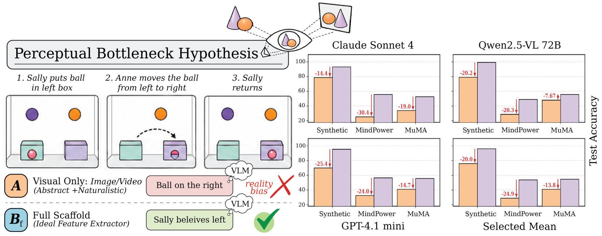

# Perception, Not Reasoning, Limits Visual Theory of Mind

**Mohamed Rayan Barhdadi · Syed Talal Wasim · Juergen Gall · Erchin Serpedin · Hasan Kurban**

**NeurIPS 2026** · **Oral at the BabyVLM Workshop, NeurIPS 2026**

[Paper](paper/paper.pdf) · [Project website](https://bmrayan.github.io/prv-perception/) · [Abstract 2D dataset](docs/DATA.md) · [Reproduce results](docs/REPRODUCE.md) · [Citation](#citation)



Why do models answer a false-belief question correctly in text but fail when the same problem is shown in pictures? We hold the reasoning task constant and vary the perceptual information supplied to the model. Ground-truth scene descriptions substantially close the gap; automatic parsers do not.

This repository contains the stimulus generator, evaluation and scoring code, saved responses, and reproduction scripts for the paper. The companion abstract 2D release contains **1,000 probes across 20 templates and three developmental stages**.

## Quick start

Python 3.10 or newer. Run commands from this directory.

```bash
python -m venv .venv
# Activate .venv first (see below)
python -m pip install -r requirements.txt
python scripts/reproduce.py
```

Activate the environment before installing: `source .venv/bin/activate` on macOS/Linux, or `.venv\Scripts\Activate.ps1` in PowerShell. The reproduction command reads the bundled results and writes tables and a numerical comparison with the paper to `results/reproduced/`. It does not make model calls or require the image dataset.

To install the companion dataset placed beside this repository:

```bash
python scripts/install_data.py --source ../hf-perception-not-reasoning
python code/abstract/run_experiments.py --phase phase1 --dry-run
```

For a dataset stored elsewhere, pass its directory to `--source`. Fresh model evaluations require `OPENROUTER_API_KEY`; see [the reproduction guide](docs/REPRODUCE.md).

## Five conditions

| Condition | Input |
|---|---|
| A | Image and question |
| B_auto | Image and an automatic perceptual description |
| B_percept | Image and ground-truth perceptual facts |
| B_full | Image and the full ground-truth description |
| C | Ground-truth text and question, without the image |

The **Perceptual Contribution Ratio** measures the fraction of the visual-to-text gap recovered by a scaffold:

```text
PCR = (accuracy with scaffold − visual-only accuracy)
      / (text-only accuracy − visual-only accuracy)
```

## Main results

Seven-model means from the paper. Abstract and MuMA-ToM entries are answer accuracy; MindPower uses its layer-averaged scoring protocol.

| Benchmark | A | B_auto | B_percept | B_full | C |
|---|---:|---:|---:|---:|---:|
| Abstract 2D, false belief | 73.9 | 75.7 | 88.8 | **98.4** | 94.5 |
| MuMA-ToM | 44.7 | 47.4 | — | **58.1** | 54.0 |

See the paper for the ThreeDWorld and VirtualHome breakdowns. Saved per-response scores for both are included. [Result provenance](docs/RESULTS.md) records model panels, sample counts, and the distinction between paper experiments and subsequent controls.

## Repository structure

```text
code/
  abstract/         Stimulus generation, evaluation, and ablations
  naturalistic/     MuMA-ToM evaluation
  mindpower_eval/   MindPower preparation, evaluation, and scoring
  controls/         Additional scaffold controls
configs/            Paper values, model panels, and source provenance
data/               Dataset installation location
results/
  reference/        Saved paper responses and scored rows
  followup/         Additional controls, kept separate
scripts/            Offline reproduction and release checks
docs/               Setup, data, and result documentation
assets/             Main paper figure
paper/              Camera-ready PDF, tables, and BibTeX
website/            Standalone project page
```

## Project website

```bash
python -m http.server 8000 --bind 127.0.0.1
```

Open **http://localhost:8000/website/**. The page includes the opening paper figure, an interactive condition comparison, sample probes, downloadable data, and a copyable BibTeX entry. It works without a frontend build step.

## Citation

```bibtex
@inproceedings{barhdadi2026perception,
  title     = {Perception, Not Reasoning, Limits Visual Theory of Mind},
  author    = {Barhdadi, Mohamed Rayan and Wasim, Syed Talal and Gall, Juergen
               and Serpedin, Erchin and Kurban, Hasan},
  booktitle = {Advances in Neural Information Processing Systems},
  year      = {2026}
}
```

If this resource helps your research, please cite the paper and [star the repository](https://github.com/bmrayan/prv-perception).

## Acknowledgments

Naturalistic experiments use [MuMA-ToM](https://github.com/SCAI-JHU/MuMA-ToM) and MindPower. Their data retain their original terms; see [data sources](docs/DATA.md). Repository organization draws on [MMToM-QA](https://github.com/chuanyangjin/MMToM-QA), [AutoToM](https://github.com/SCAI-JHU/AutoToM), [FANToM](https://github.com/skywalker023/fantom), and [ToMi](https://github.com/facebookresearch/ToMi). The project page follows the publication-focused layout of [IRIS](https://github.com/KurbanIntelligenceLab/iris-bench).

## License

Original code is released under [MIT](LICENSE). The companion abstract 2D dataset uses CC BY 4.0. External benchmarks remain under their original terms; see [data documentation](docs/DATA.md).
